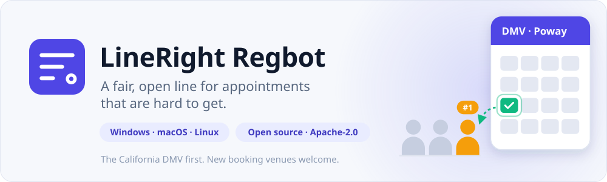
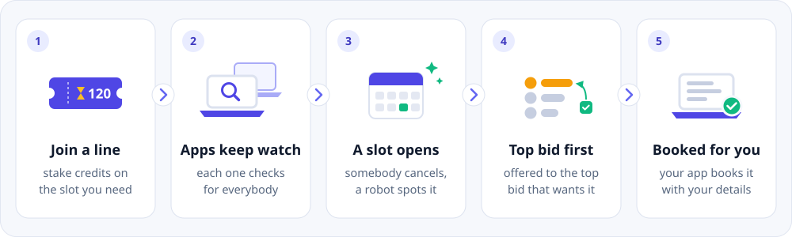
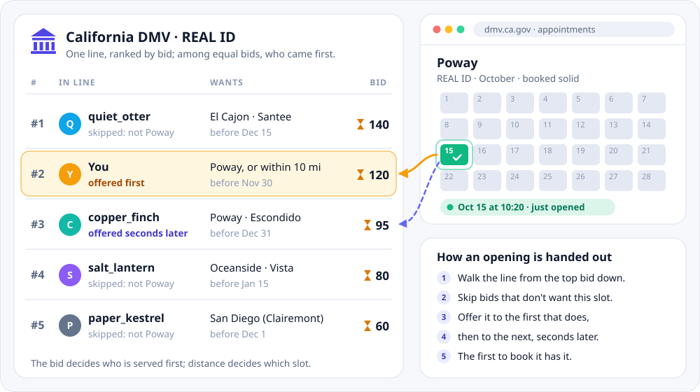
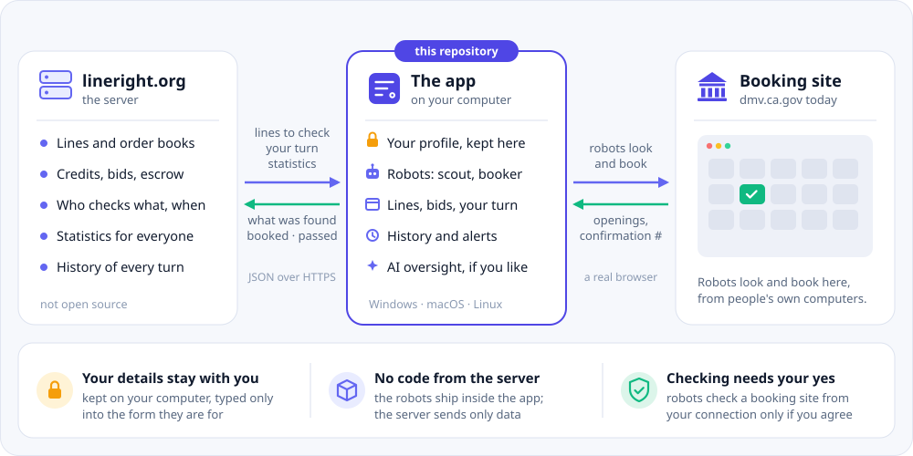
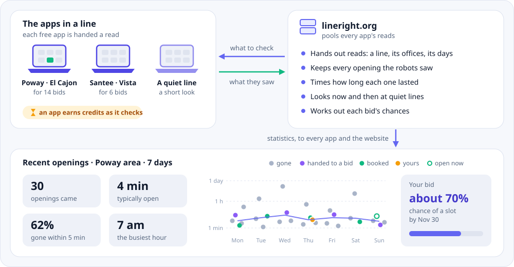
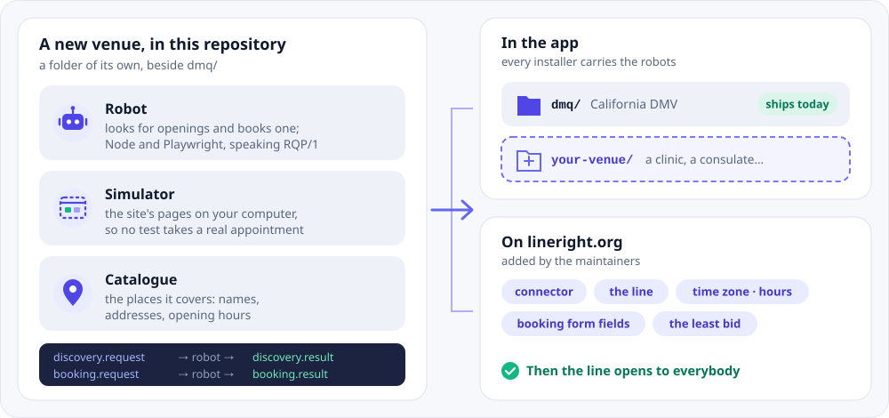

<p align="center">
  
</p>

<p align="center">
  <a href="https://github.com/grandrew/lineright-client/releases/latest"></a>
  <a href="LICENSE"></a>
  <a href="https://lineright.org/#download"></a>
</p>

<p align="center">
  <a href="https://lineright.org"><b>lineright.org</b></a> ·
  <a href="https://lineright.org/#download">Download</a> ·
  <a href="#how-it-works">How it works</a> ·
  <a href="#monitoring-and-statistics">Statistics</a> ·
  <a href="#add-a-booking-venue">Add a venue</a> ·
  <a href="#build-and-run-it">Build it</a>
</p>

Some appointments are almost impossible to get. The California DMV's calendars
are booked solid for months. The only near dates are cancellations, and they
are gone within minutes. Whoever gets one is usually whoever happened to
refresh the page at the right moment, or ran a bot.

**LineRight** replaces that scramble with an open, orderly line. You join a
line on [lineright.org](https://lineright.org) and stake credits on the slot
you need. Everybody's app takes turns watching the booking site for everybody.
When a slot opens, the line decides in the open whose it is, and that person's
own app books it.

This repository is **LineRight Regbot**, the desktop app that does the watching
and the booking, together with the **robots** it runs. It is open source under
the [Apache License 2.0](LICENSE). You can read exactly what runs on your
computer, and you can [add a line for another booking site](#add-a-booking-venue).

## How it works

<p align="center">
  
</p>

1. **Join a line.** Pick a line, such as *California DMV · REAL ID*. Choose the
   offices you can get to (or a distance from your ZIP code), how soon you
   need the appointment, and how many credits to stake. Your bid is your place
   in line.
2. **Apps keep watch.** The server hands each free app a *read*: a line, its
   offices and its days. The app's robot looks at the booking site and reports
   what it saw. Your app looks for everybody, and everybody's app looks for
   you. An app earns credits for the hours it spends checking.
3. **A slot opens.** Somebody cancels, and the next robot to look at that
   office sees the free slot.
4. **The line decides.** The server walks the line from the top bid down. It
   offers the slot to the first bid that wants it, then to the next one a few
   seconds later. Whoever books it first has it, and the others keep their
   places.
5. **Your app books it.** Your app books the slot with the details kept on
   your computer. If you would rather book it yourself, it opens the booking
   page with your details already typed in. Your staked credits are spent
   only when you book. If you pass, you keep your place. If you let the time
   run out, you leave the line with 70% of your bid back (the site's
   setting).

## A DMV line, up close

<p align="center">
  
</p>

The California DMV is the first booking site with lines on lineright.org: REAL
ID, driver's licenses and ID cards, vehicle registration, drive tests (car,
commercial and motorcycle) and knowledge test re-evaluations. The app's
[catalogue](dmq/catalog/) lists 187 DMV offices.

Every line has a public order book. The rules for who gets a slot are simple
enough to check for yourself:

- **The bid decides who is served first, and distance decides which slot.**
  Bids are ranked by amount, and equal bids by who came first. Each bidder is
  offered the earliest slot they will take. Among equally early slots, they
  get the nearest office.
- **Your rivals are only the bids that want what you want.** A higher bid for
  an office 40 miles away is not in your way.
- **A slot is offered to a few people, a few seconds apart.** The first to
  book it has it. The others are told it went, and they keep their places.
- **Nothing is wasted.** If you pass on a turn, you keep your place. If you
  lower a bid, the difference comes back. A bid whose time passes with
  nothing booked widens itself a step at a time, unless you turn that off.
- **You can see the numbers.** For each amount you might bid, the site shows
  how many people ahead of you want your offices. It also shows how soon you
  would likely book, worked out from the line's openings over the last week.

## Who does what

<p align="center">
  
</p>

| | Runs on | Does |
|---|---|---|
| **The app** (this repository) | Your computer | Keeps your profile. Runs the robots when the server asks. Shows the lines, your bids, your turn and your history. Books your slot. |
| **[lineright.org](https://lineright.org)** | LineRight's server (not open source) | Keeps the lines, their order books, credits and escrow. Decides which app checks what, and whose turn it is. Pools what the apps see into statistics. |
| **The booking site** | The venue's website, such as dmv.ca.gov | Holds the appointments. The robots look and book there, from each person's own internet connection. |

- **The robots ship inside the app.** The server never sends code, only data:
  a read to do, a turn to book, numbers to show. What runs on your computer is
  what is in this repository, at the version you have installed. Each robot
  runs as a process of its own, with the browser the installer carries. It
  takes one JSON envelope in and gives one back ([RQP/1](dmq/README.md#rqp1)).
- **Your profile stays on your computer.** Your name, date of birth, license
  number and other details are encrypted where your system allows. They are
  typed only into the booking form they are for, when it is your turn.
- **The app decides where the robots may go, not the server.** They go to the
  real booking site, or to a simulator on your own computer when the server is
  there too. A server that names anywhere else gets no robot.
- **There are two yeses.** Checking lines for everybody asks for your yes
  once, because it is automated traffic from your own address. Booking for you
  can be switched off in Settings. The app then opens the booking page with
  your details typed in, and you book it yourself.

The app pairs with your lineright.org account by a code you approve in your
browser, so it never sees your password.

## Monitoring and statistics

<p align="center">
  
</p>

The server decides who looks where. The apps do the looking. Everything they
see comes back to everybody as statistics.

- **Reads.** At each sync an app tells the server what it can do, and a free
  app is handed a read. The read is a line with bidders, with its offices and
  days. The server picks the line the fewest apps are reading, then the one
  looked at longest ago. An app does one read at a time and none while it is
  booking. It gives back the read in hand when it closes.
- **Quiet lines are watched too.** Now and then an app with nothing to read is
  handed a short look at offices nobody has checked for a while. So every line
  has something to show, and a line the robots cannot read gets noticed. If
  the robots cannot read a line at all, the server may ask one app's AI to look
  at the booking site and say what changed. The server pays for that, not
  your credits.
- **Statistics for everyone.** The server pools every read. It sends the
  numbers back to every app and shows the same numbers on the website:
  - **Recent openings** on a line or at your offices: how many came, how long
    each lasted, how many were gone within five minutes, and the busiest hour.
    A plot shows each opening by day, colored by what became of it.
  - **The soonest time seen** on each line, and how reading its offices is
    going.
  - **Your chances.** The join form offers three ways to ask: the soonest with
    an even chance, the best bet, and the surest. Each shows its chance of an
    appointment by its end date. The site works this out from last week's
    openings against the bids ahead of yours.
  - **Suggestions.** These include an opening a wider bid would take, the
    nearest opening and why your bid does not take it, and what would have
    caught the openings your bid missed.
- **Credits for checking.** Each hour an app spends checking lines earns its
  account credits, 0.2 an hour by default. Every account is also topped back
  up to 35 credits each week.

## Add a booking venue

<p align="center">
  
</p>

LineRight started with the California DMV. A line can be for any booking site
where appointments are scarce: another state's DMV, a consulate, a clinic or a
campground. A venue is made of a few pieces, and most of them live in this
repository:

| Piece | What it does | Where | For the DMV |
|---|---|---|---|
| **Robot** | Looks for openings and books one. It speaks RQP/1: one JSON envelope in on stdin, one out on stdout. | Here | [`dmq/`](dmq/) |
| **Simulator** | A copy of the booking site that runs on your own computer. The robot is built and tested against it, so no test ever takes a real appointment. | Here | [`simulators/ca-dmv/`](simulators/ca-dmv/) |
| **Catalogue** | The places a line covers: names, addresses, coordinates and opening hours. | Here, with a copy on the server | [`dmq/catalog/`](dmq/catalog/) |
| **Connector and line** | The server's side. It says which robot to ask for, which places a bid may name and what the booking form needs. It also sets the line's hours, time zone and least bid. | lineright.org | `dmv.ca.gov.qmatic` |

**To bring a new venue:**

1. **Build a simulator** of the site in `simulators/<site>/`, shaped like
   [`simulators/ca-dmv/`](simulators/ca-dmv/). See
   [Writing one for another site](simulators/README.md#writing-one-for-another-site).
2. **Write the robot** in a folder of its own beside `dmq/`. It needs two
   entry points that speak RQP/1, and tests that drive it through your
   simulator.
3. **List the places** the line covers, in the
   [catalogue format](dmq/README.md#the-office-catalogue).
4. **Open a pull request** named "A line for &lt;site&gt;", or ask for the
   site at [lineright.org/request](https://lineright.org/request). The
   maintainers add the connector and the line on the server.

A robot is a program you can drive by hand. With `RQP_MODE=simulate`, the DMV
scout makes up its openings without a browser or a network:

```bash
cd dmq && npm ci
echo '{"protocol":"RQP/1","kind":"discovery.request",
       "target":{"site":"ca-dmv","connector":"dmv.ca.gov.qmatic","queue":"vehicle-registration"},
       "offices":["Poway","El Cajon"],"window":["2026-12-01","2027-01-31"],
       "hours":["08:00","17:00"],"timezone":"America/Los_Angeles"}' \
  | RQP_MODE=simulate node bin/rqp-scout.js
# {"protocol":"RQP/1","kind":"discovery.result","status":"confirmed",
#  "message":"Found 4 slot(s) across 2 office(s).","offers":[{"office_name":"Poway",
#  "slot_date":"2026-12-01","slot_time":"09:00", …}, …], …}
```

**Every robot follows the same rules:**

- Tests run against the simulator, never the real site. A few read-only
  checks, run by hand, are as far as a robot goes on the real site in testing.
- A robot never solves a human check (a CAPTCHA). It stops and reports it, and
  the person is asked to clear it themselves.
- A robot books only the slot the request names, with the details the request
  carries, and only when booking is switched on.
- A robot reports what the site said. A booking with no confirmation on the
  page is reported as unconfirmed, never as confirmed.

**What is still missing.** Today the app runs one robot, the DMV's. It lets
robots go only to dmv.ca.gov, and its profile and wording are the DMV's.
Opening a second site needs three things:

- a robot registry in the app, with a small manifest for each robot: its
  name, connector, entry points and the addresses it may visit;
- profile fields that each line asks for;
- a general connector on the server, driven by that manifest.

[docs/adding-a-line.md](docs/adding-a-line.md) lists every gap, in the order
to close them. Pull requests for any of them are welcome.

## What leaves your computer

| What | Where it goes |
|---|---|
| Your profile: name, date of birth, license, passport and Social Security numbers, address, email, phone | Nowhere but the booking form it is for, when it is your turn. It is kept on your computer, encrypted where your system allows. |
| Sign-ins you bring across from a browser you use | Only into the app's own browser tabs |
| Your bids: which line, which offices or how far, which times, how much; how each turn ended, with the booking site's confirmation number | lineright.org |
| What the robots found when the server asked: offices, days and times, the same for everybody | lineright.org |
| A name for this device, the app's version and system, and how quickly it answers | lineright.org |
| The numbers on **Settings → Advanced** | lineright.org, only when you press **Share now** or let it share every six hours |
| A trace of what the app did, with every profile detail and anything shaped like one taken out | lineright.org, a little at a time, only when the site asks. **Settings → Advanced** shows it and turns it off. |
| With AI booking oversight: the page the robot is stuck on, as text, with your details replaced by placeholders | DeepSeek's model, asked through lineright.org |
| The app's own logs (**Help → Open the logs folder**) | Nowhere |

[desktop/README.md](desktop/README.md) has the long version of each. The
site's [privacy page](https://lineright.org/privacy) says what it keeps, and
for how long.

## AI booking oversight

Booking sites change. A button gets renamed, or a label reworded, and a robot
that looks for the old words stops. When that happens, the app can let an AI
finish the booking instead of handing you the page. The AI takes over the
robot's browser in the middle of the booking. It reads the page as text, with
your details replaced by placeholders such as `[first_name]`, which the app
fills in on your computer. A booking counts as made only when its confirmation
number is on the page. Each intervention is reported, so the robot gets fixed
before the next person's booking fails the same way.

Oversight is paid from bought credits: about 2 credits a step, and at most 150
for one booking. It is on once you have bought credits, and
**Settings → AI booking oversight** turns it off. For what it may and may not
do, see [desktop/docs/ai-oversight.md](desktop/docs/ai-oversight.md).

## Download

Get the installers from [lineright.org](https://lineright.org/#download) or
from this repository's [releases](https://github.com/grandrew/lineright-client/releases/latest):

- **Windows:** x64 and ARM64
- **macOS:** Apple silicon and Intel
- **Linux:** AppImage and .deb

An installed app updates itself from these releases. When a Mac cannot
install an update by itself, the app says so and shows the steps. The
installers are not yet signed with an Apple or Microsoft certificate, so your
system asks for one extra confirmation the first time you open the app.
lineright.org's download page shows how.

The app looks and books only while it is open, on a computer that is awake
and online. It keeps your computer from going to sleep while it runs, but it
cannot stop a laptop from sleeping when its lid closes.

## What is in this repository

| Folder | What it holds |
|---|---|
| [`desktop/`](desktop/) | The Electron app: its screens, signing in by code, the profile kept on your computer, importing details from a browser you already use, the robots it runs for the site, booking a turn, history and AI oversight. [desktop/README.md](desktop/README.md) is the long version. |
| [`dmq/`](dmq/) | The California DMV robots (Node and Playwright). `bin/rqp-scout.js` looks for openings, `bin/rqp-handler.js` books one, and `catalog/` lists the offices. [dmq/README.md](dmq/README.md) explains how they work and where they stop. |
| [`simulators/`](simulators/) | Copies of booking sites that run on your own computer. The robots are built and tested against them, so no test takes a real appointment. [`ca-dmv/`](simulators/ca-dmv/) is the California DMV's. |
| [`docs/`](docs/) | [Adding a line for another booking site](docs/adding-a-line.md), and the pictures in this page. |

## Build and run it

```bash
cd dmq && npm ci && cd ..
cd desktop && npm ci
npm run bundle          # the robots' browser, as an installer carries it
npm start               # pairs with lineright.org (Ubuntu 24.04+: npm start -- --no-sandbox)
npm test                # the smoke tests need a display: xvfb-run -a npm test on Linux
```

To test the robots on their own, and through the DMV simulator:

```bash
cd dmq && npm test && cd ..
cd simulators/ca-dmv
npm test                # the simulator's own tests
npm run test:robots     # the real robots through it, in a real Chromium
npm start               # or open it yourself, at http://127.0.0.1:8787
```

**Developer mode** (View → Developer mode, or `npm start -- --developer`)
shows test sites, other servers and Chromium's developer tools. If a checkout
of the server is beside this one, developer mode also offers
**Practice on this computer**. That runs the whole service and the DMV
simulator on your own machine. Nothing of the server, and no simulator, is
ever built into an installer.

Installers are built by
[`.github/workflows/desktop-release.yml`](.github/workflows/desktop-release.yml)
when a `desktop-v<version>` tag is pushed, or by hand with `npm run dist` in
`desktop/`.

## Contributing

Issues and pull requests are welcome, from a typo to a whole new venue.

- Run `npm test` in both `desktop/` and `dmq/` before you send a change. On
  Linux, run `xvfb-run -a npm test` in `desktop/`, because its smoke tests
  want a display.
- Please do not point anything at dmv.ca.gov beyond the read-only live checks
  (`npm run test:live` in `dmq/`), and run those sparingly. It is the state's
  website, and every appointment on it is somebody's.
- A change to what the app sends the server, such as the sync body or a new
  kind of event in the trace, needs a test that nothing personal rides along.
  `desktop/test/scrub.test.js` throws a random profile at the trace in every
  spelling a form or a URL might use. Add your test there.
- Report security problems privately, not in an issue. See
  [SECURITY.md](SECURITY.md).

## License

Copyright 2026 The LineRight Regbot authors. Licensed under the
[Apache License, Version 2.0](LICENSE). See also [NOTICE](NOTICE).
